# Modelo de datos — CEFTE

Fuente: esquema real de la base de datos `cefte_erp` (MySQL 8), extraído el 19-10-2026.

> **Nota de nomenclatura.** Las tablas y columnas físicas de la BD están en inglés (herencia de Laravel y del catálogo de productos migrado). Las figuras de esta tesis presentan el modelo con sus **nombres equivalentes en castellano**. La sección 3 ([Equivalencias](#3-equivalencias-bd--diagrama)) permite rastrear cualquier elemento del diagrama hasta su nombre real en la BD.

## Convenciones de lectura

- `PK` = llave primaria · `UK` = restricción única · `FK` = llave foránea.
- El símbolo `?` después del tipo indica atributo anulable (`NULL`).
- Todas las tablas incluyen además las columnas de control `created_at` y `updated_at`; se omiten en las figuras por legibilidad.
- El tipo `texto(n)` equivale a `VARCHAR(n)` y `decimal` a `DECIMAL(m,n)`.

---

## 1. Figuras

### Figura 1. Vista general del modelo de datos

Recorrido global por los cinco subsistemas: personal y seguridad, catálogo, ingresos, ventas/cobros y salidas con su efecto en inventario.

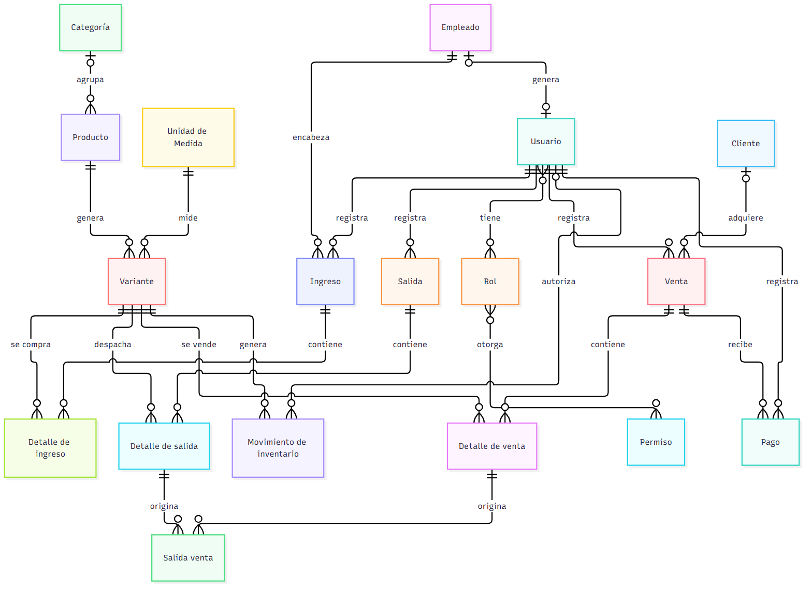

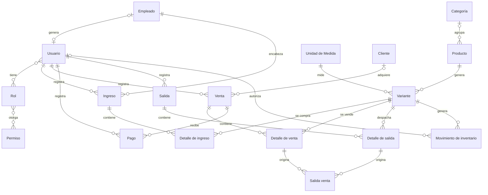

### Figura 2. Subsistema de personal, seguridad y autorización

Un empleado puede generar a lo sumo un usuario de acceso. El usuario recibe roles, y cada rol agrupa permisos que habilitan los módulos del sistema.

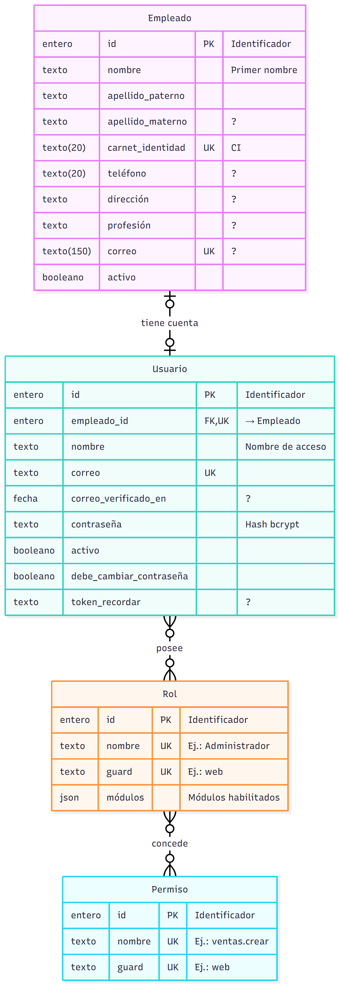

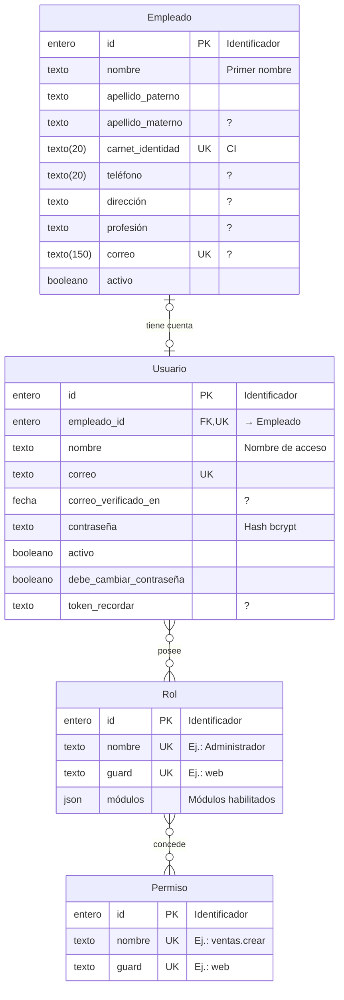

### Figura 3. Catálogo de productos

El producto es la ficha maestra (nombre, código, categoría). Las **variantes** representan cada presentación comercializable y son las que efectivamente se compran, se venden y llevan el stock. Una variante referencia tres unidades de medida: la de venta, la base y la de empaque (con su factor de conversión).

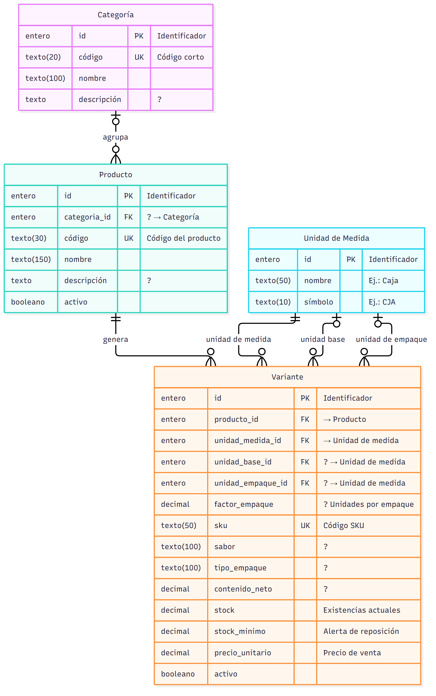

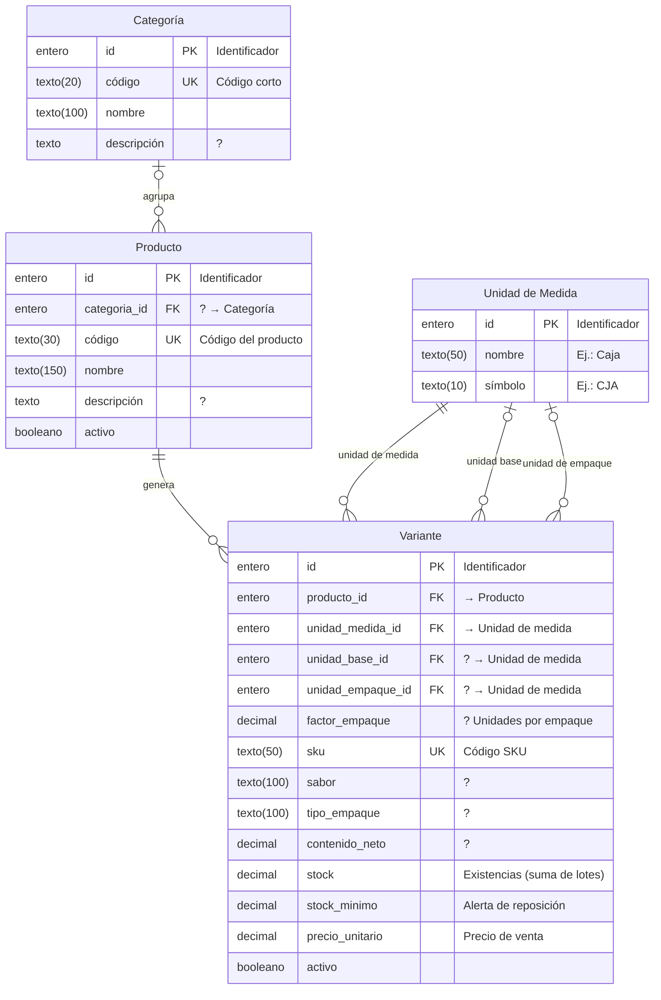

### Figura 4. Inventario (kardex), lotes y numeración correlativa

Todo movimiento de stock queda registrado con su saldo anterior y posterior. El par `referencia` + `referencia_id` identifica el documento que origina el movimiento (ingreso, venta o salida). El stock ya no vive en la variante: se controla por **lote**, y las salidas se resuelven por **FEFO** (First Expired, First Out), es decir, primero sale el lote que caduca antes. Las tablas de numeración sostienen la emisión de códigos y de números de documento.

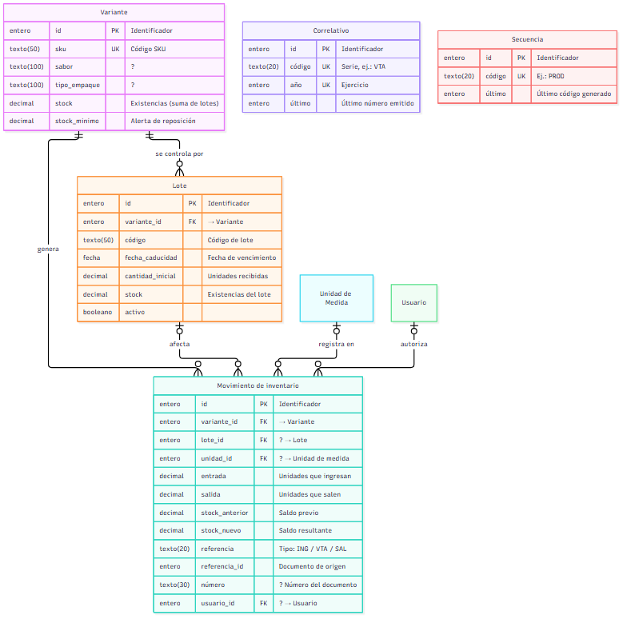

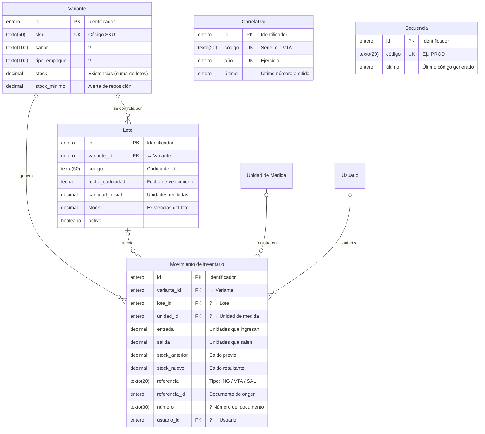

### Figura 5. Ingresos de mercadería

Cada ingreso registra el documento de recepción, el encargado responsable y su detalle línea a línea. Los detalles apuntan a variantes concretas y fijan el costo unitario aplicado.

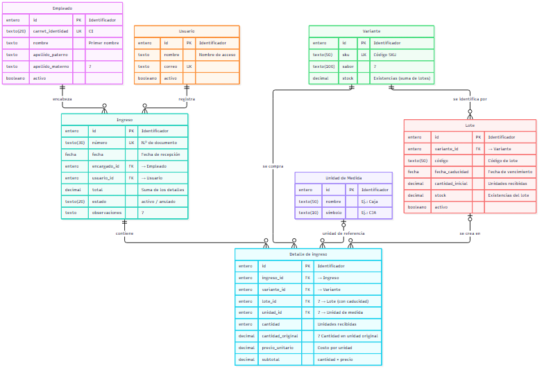

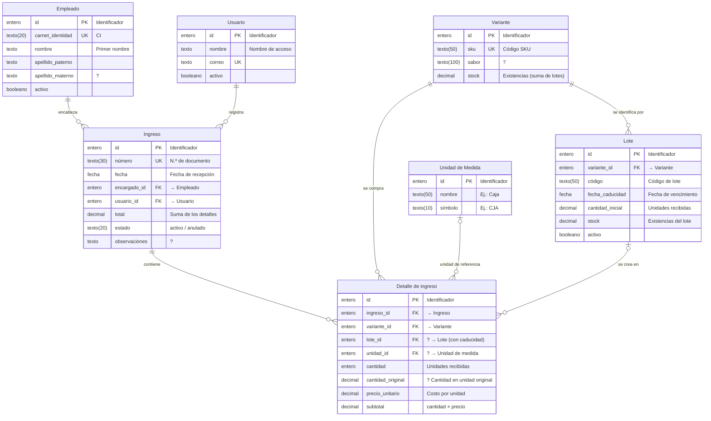

### Figura 6. Ventas y cobros

La venta puede quedar a nombre de un cliente (opcional) y generarse en contado o a crédito. En el segundo caso, `saldo_pendiente` refleja la deuda y los **pagos** la amortizan parcial o totalmente.

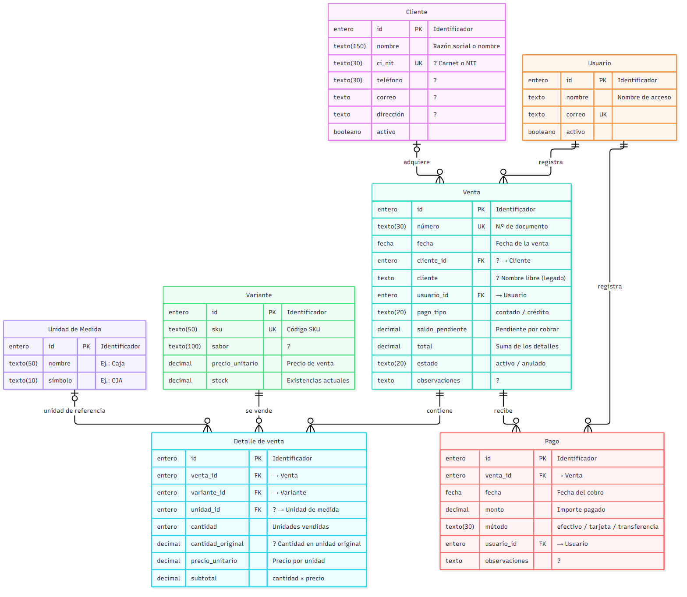

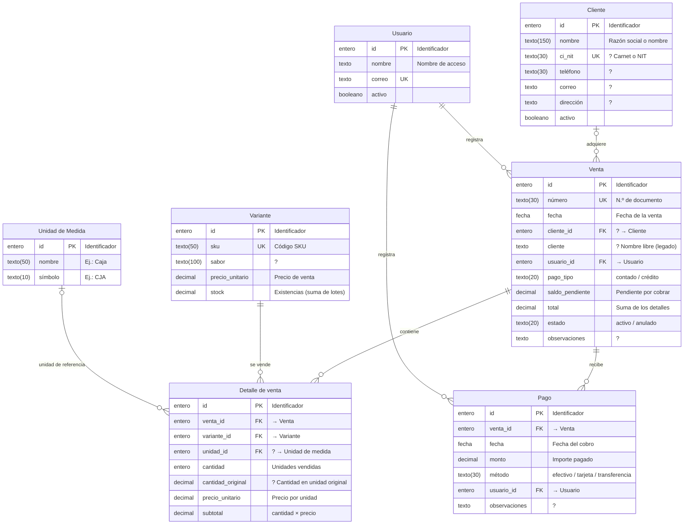

### Figura 7. Salidas de almacén y su vinculación con las ventas

La salida retira mercadería del almacén por distintos motivos. El pivote **Salida venta** enlaza cada línea de salida con las líneas de venta que la consumen, lo que permite trazar qué parte de un despacho correspondió a cada venta.

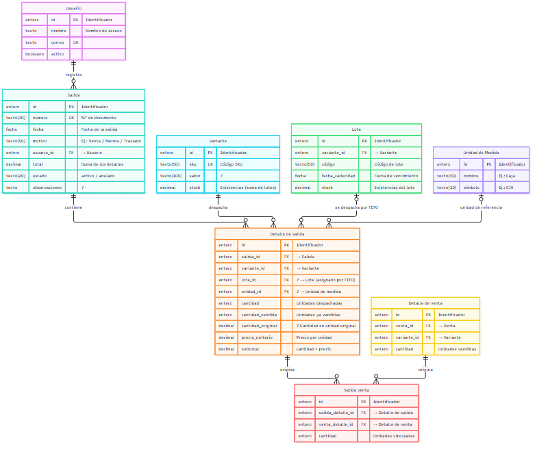

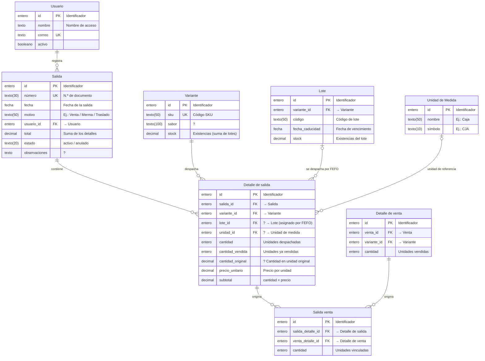

---

## 2. Reglas de integridad referencial

| Tabla origen | Columna | Tabla destino | Acción al eliminar el padre |
|---|---|---|---|
| users | employee_id | employees | SET NULL |
| products | category_id | categories | SET NULL |
| product_variants | product_id | products | CASCADE |
| product_variants | unit_measure_id | unit_measures | RESTRICT |
| product_variants | unidad_base_id | unit_measures | RESTRICT |
| product_variants | unidad_empaque_id | unit_measures | RESTRICT |
| ingresos | encargado_id | employees | RESTRICT |
| ingresos | user_id | users | RESTRICT |
| ingreso_detalles | ingreso_id | ingresos | CASCADE |
| ingreso_detalles | product_variant_id | product_variants | RESTRICT |
| ingreso_detalles | unidad_id | unit_measures | SET NULL |
| ventas | cliente_id | clientes | SET NULL |
| ventas | user_id | users | RESTRICT |
| venta_detalles | venta_id | ventas | CASCADE |
| venta_detalles | product_variant_id | product_variants | RESTRICT |
| venta_detalles | unidad_id | unit_measures | SET NULL |
| pagos | venta_id | ventas | RESTRICT |
| pagos | user_id | users | RESTRICT |
| salidas | user_id | users | RESTRICT |
| salida_detalles | salida_id | salidas | CASCADE |
| salida_detalles | product_variant_id | product_variants | RESTRICT |
| salida_detalles | unidad_id | unit_measures | SET NULL |
| salida_detalle_venta_detalle | salida_detalle_id | salida_detalles | CASCADE |
| salida_detalle_venta_detalle | venta_detalle_id | venta_detalles | CASCADE |
| movimientos_inventario | product_variant_id | product_variants | RESTRICT |
| movimientos_inventario | unidad_id | unit_measures | SET NULL |
| movimientos_inventario | user_id | users | SET NULL |

---

## 3. Equivalencias BD ↔ diagrama

### 3.1 Entidades

| Tabla real en la BD | Entidad en el diagrama |
|---|---|
| users | Usuario |
| employees | Empleado |
| roles | Rol |
| permissions | Permiso |
| categories | Categoría |
| products | Producto |
| product_variants | Variante |
| unit_measures | Unidad de Medida |
| clientes | Cliente |
| ingresos | Ingreso |
| ingreso_detalles | Detalle de ingreso |
| ventas | Venta |
| venta_detalles | Detalle de venta |
| pagos | Pago |
| salidas | Salida |
| salida_detalles | Detalle de salida |
| salida_detalle_venta_detalle | Salida venta (pivote) |
| movimientos_inventario | Movimiento de inventario |
| correlativos | Correlativo |
| secuencias | Secuencia |

### 3.2 Atributos cuyo nombre físico está en inglés

| Tabla | Columna real | Atributo en el diagrama |
|---|---|---|
| users | employee_id | empleado_id |
| users | name | nombre |
| users | email | correo |
| users | email_verified_at | correo_verificado_en |
| users | password | contraseña |
| users | is_active | activo |
| users | must_change_password | debe_cambiar_contraseña |
| users | remember_token | token_recordar |
| employees | first_name | nombre |
| employees | first_surname | apellido_paterno |
| employees | second_surname | apellido_materno |
| employees | identity_card | carnet_identidad |
| employees | phone | teléfono |
| employees | address | dirección |
| employees | profession | profesión |
| employees | email | correo |
| employees | is_active | activo |
| categories | code | código |
| categories | name | nombre |
| categories | description | descripción |
| products | category_id | categoria_id |
| products | code | código |
| products | name | nombre |
| products | description | descripción |
| products | is_active | activo |
| product_variants | product_id | producto_id |
| product_variants | unit_measure_id | unidad_medida_id |
| product_variants | flavor | sabor |
| product_variants | packaging_type | tipo_empaque |
| product_variants | net_content | contenido_neto |
| product_variants | minimum_stock | stock_minimo |
| product_variants | unit_price | precio_unitario |
| product_variants | is_active | activo |
| lotes | product_variant_id | variante_id |
| lotes | codigo | código |
| lotes | fecha_caducidad | fecha_caducidad |
| lotes | cantidad_inicial | cantidad_inicial |
| lotes | stock | stock |
| lotes | is_active | activo |
| unit_measures | name | nombre |
| unit_measures | symbol | símbolo |
| roles | name | nombre |
| roles | guard_name | guard |
| roles | modulos | módulos |
| permissions | name | nombre |
| permissions | guard_name | guard |

### 3.3 Atributos genéricos renombrados (aparecen en varias tablas)

| Columna real | Atributo en el diagrama | Tablas donde aparece |
|---|---|---|
| user_id | usuario_id | ingresos, ventas, pagos, salidas, movimientos_inventario |
| product_variant_id | variante_id | ingreso_detalles, venta_detalles, salida_detalles, movimientos_inventario, lotes |
| lote_id | lote_id | ingreso_detalles, salida_detalles, movimientos_inventario |
| fecha_caducidad | fecha_caducidad | lotes |
| numero | número | ingresos, ventas, salidas, movimientos_inventario |
| telefono | teléfono | clientes |
| direccion | dirección | clientes |
| email | correo | clientes |
| metodo | método | pagos |
| anio | año | correlativos |
| ultimo | último | correlativos, secuencias |

Los atributos `sku`, `stock`, `subtotal`, `total`, `estado`, `fecha`, `cantidad`, `motivo`, `referencia` y `pago_tipo` conservan en el diagrama su nombre exacto de la BD. En `product_variants` la columna `stock` ya no existe físicamente: el diagrama muestra el stock de la variante como la suma de sus lotes (atributo derivado).

---

## 4. Tablas no representadas en las figuras

| Grupo | Tablas | Motivo |
|---|---|---|
| Infraestructura de Laravel | cache, cache_locks, sessions, jobs, job_batches, failed_jobs, migrations, password_reset_tokens | Internas del framework, sin valor de negocio |
| Autorización (Spatie) | model_has_roles, model_has_permissions, role_has_permissions | Pivotes técnicos de la librería; en la Figura 2 se representa el vínculo conceptual Usuario–Rol–Permiso |
| Legado de migración | productos_vieja_mapping, categorias_vieja_mapping | Tablas auxiliares usadas únicamente para trasladar los datos del catálogo antiguo |

---

## 5. Regenerar las figuras

Los archivos fuente son los `.mmd` de [`docs/diagramas/`](diagramas/) y ya están exportados en PNG y SVG.

```powershell
npx -y @mermaid-js/mermaid-cli -i docs\diagramas\fig3_catalogo.mmd -o docs\diagramas\fig3_catalogo.png -b white -s 2
npx -y @mermaid-js/mermaid-cli -i docs\diagramas\fig3_catalogo.mmd -o docs\diagramas\fig3_catalogo.svg -b white
```

Si mermaid-cli no encuentra Chrome, indícale la ruta con un archivo de configuración (`-p config.json`):

```json
{ "executablePath": "C:\\Program Files\\Google\\Chrome\\Application\\chrome.exe", "args": ["--no-sandbox"] }
```

También puede pegarse cualquier bloque `mermaid` de este documento en <https://mermaid.live> para exportar la imagen en el formato deseado.
