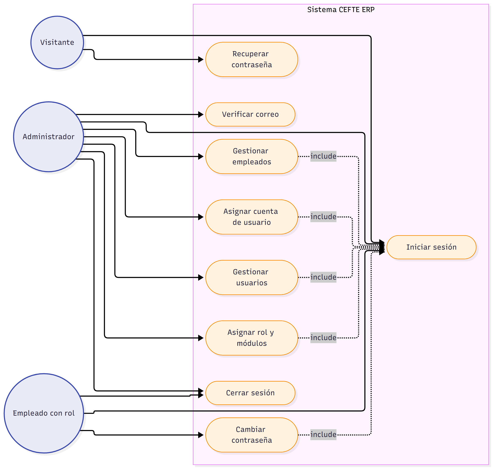
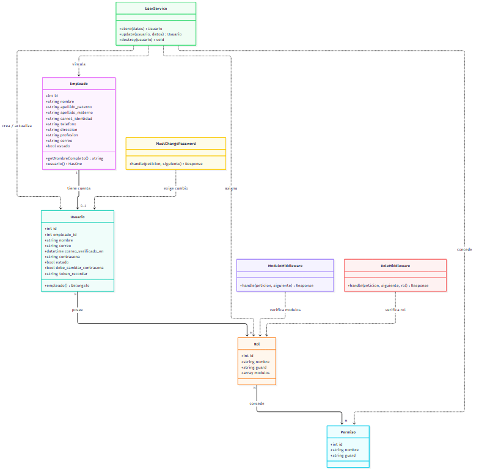
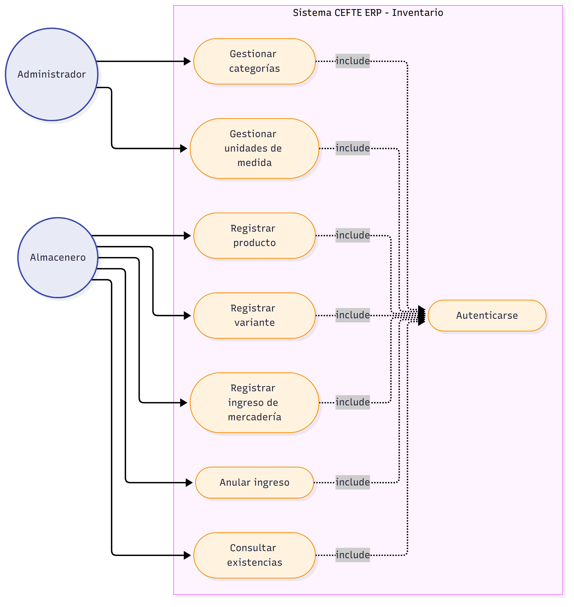
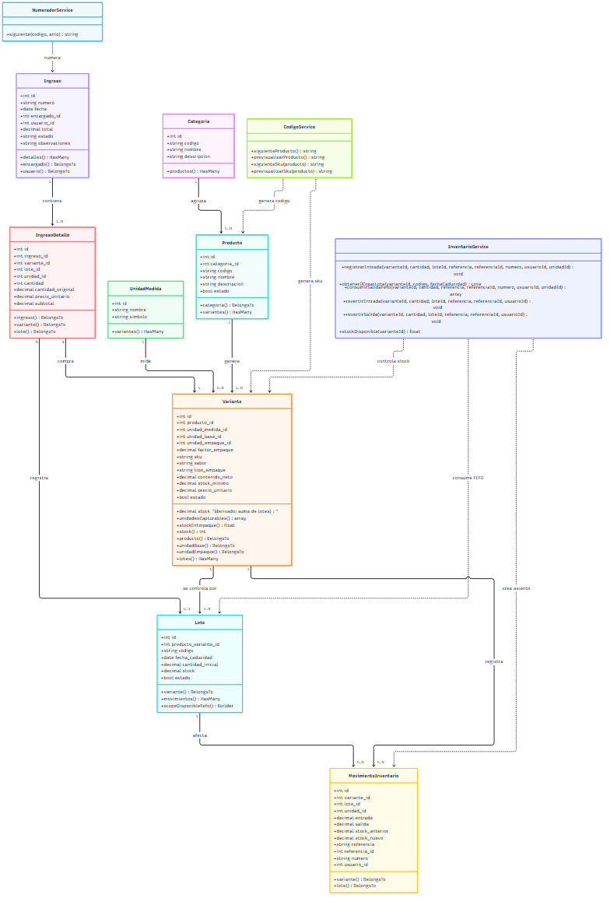
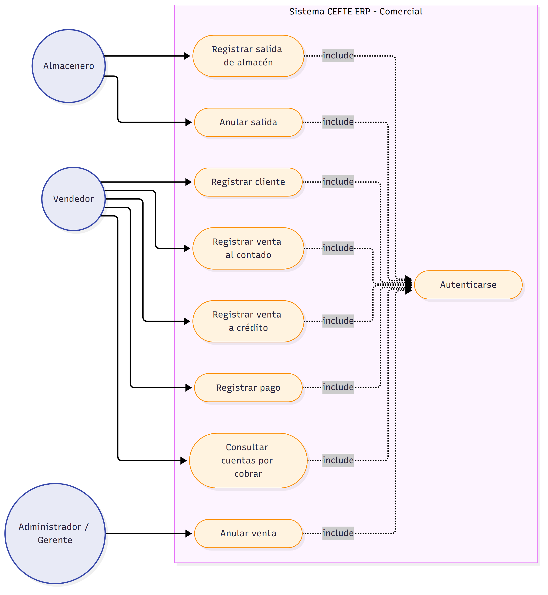
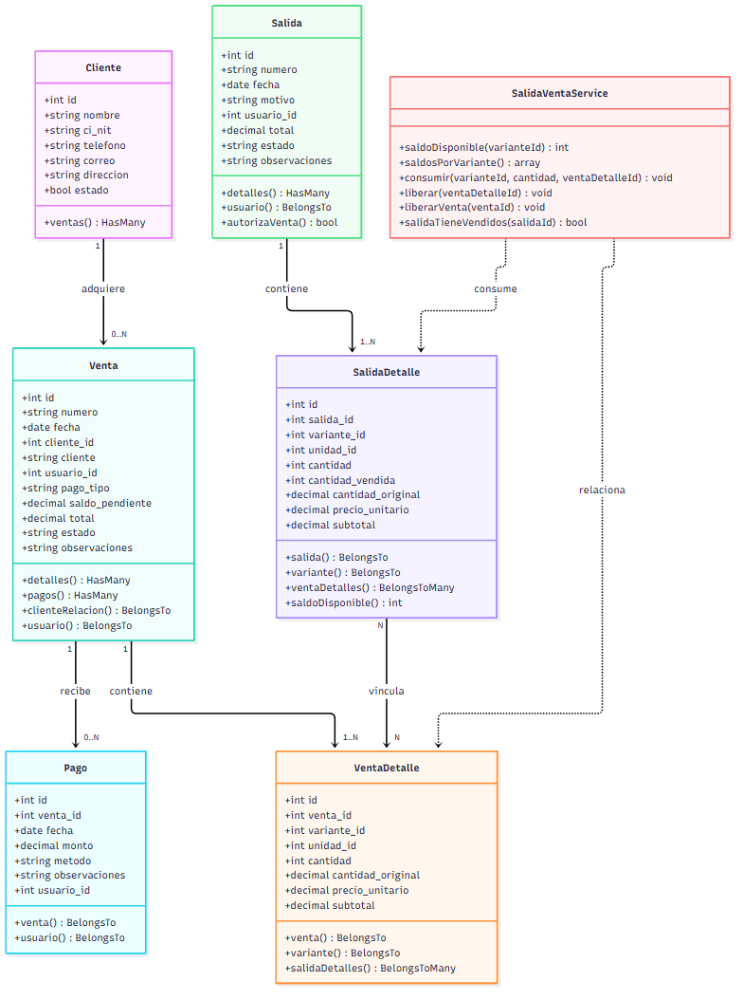
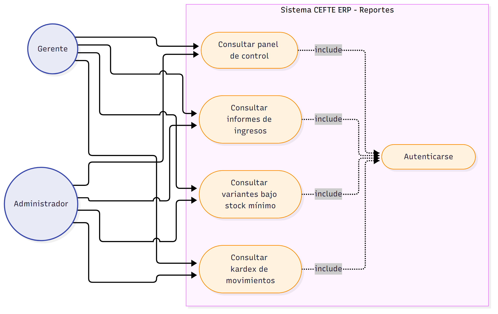
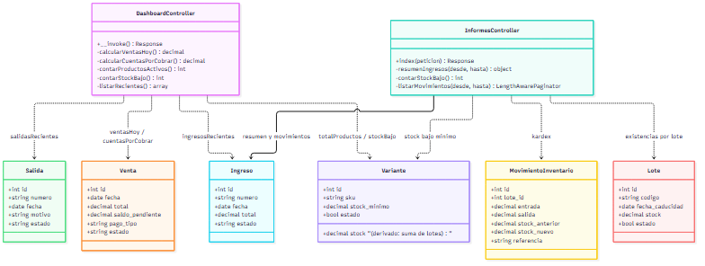

# CAPÍTULO III: PROPUESTA DE INNOVACIÓN O SOLUCIÓN DEL PROBLEMA

El presente capítulo se muestra el proceso del desarrollo software del sistema web de gestión de inventarios y ventas del almacén de producción del Instituto Tecnológico Eterazama, empleando la metodología XP que permite utilizar los métodos de la planificación y ejecución de las fases de desarrollo del software.

## 3.1. Identificación de Roles

A continuación, se siguen los roles de XP para los actores en el proyecto de desarrollo del software.

El estudiante asume el rol de cliente, desarrollador, tester y gestor de proyectos ya que se encargará de implementar el producto del software y recoger los requerimientos de los usuarios.

El tutor(a) asumirá el rol de tracker y coach quien hace el seguimiento acerca de los avances del proyecto software.

## 3.2. Identificación de Usuarios

Son las personas involucradas que brindarán información para los requerimientos, y que además operan el sistema una vez implementado:

**Administrador:** Es el encargado de administrar el padrón de empleados, crear las cuentas de usuario, asignar los roles y módulos, y mantener los parámetros del sistema (categorías, unidades de medida). Posee acceso total.

**Gerente:** Es el encargado de supervisar la operación del almacén, validar los ingresos y salidas, autorizar la anulación de documentos y consultar los informes e indicadores del negocio. Posee acceso total.

**Almacenero:** Es el encargado de registrar los ingresos de mercadería, controlar las existencias físicas y registrar las salidas del almacén según el motivo correspondiente.

**Vendedor:** Es la persona encargada de registrar los clientes, realizar las ventas al contado y a crédito, y registrar los pagos de las cuentas por cobrar.

## 3.3. Implementación de la primera iteración

### 3.3.1. Fases de planificación de la primera iteración.

#### 3.3.1.1. Especificación de historias de usuarios de la primera iteración.

A continuación, se presentan los requerimientos y necesidades mediante el artefacto de historias de usuarios, especificando datos precisos y correctos. Las historias describen las funcionalidades clave que deben ser implementadas en esta iteración, con el objetivo de asegurar el acceso al sistema y la administración del personal y de las cuentas de usuario.

**Tabla 1. Historia del usuario iteración 1 "Acceso al sistema"**

| Nombre de historia | Acceso al sistema | HU-01 |
|---|---|---|
| Prioridad en negocio | Alto | Responsable: Estudiante |
| Puntos estimados | 8 | Iteración asignada: 1 |

| Como | Administrador, Gerente, Almacenero, Vendedor |
|---|---|
| Necesito | Brindar acceso al sistema mediante correo y contraseña institucional |
| Para | Asegurar la integridad de los datos del almacén |

| Criterios de aceptación | Emplear autenticación por correo y contraseña con cifrado. |
|---|---|
| | Asignar un rol de usuario y derivar de él los módulos permitidos. |
| | Restringir el acceso a módulos no autorizados con HTTP 403. |
| | Permitir cerrar sesión. |
| | Almacenar información personal del usuario vinculada a su ficha de empleado. |
| | Recuperar la contraseña mediante enlace por correo. |

Nota: Historia de usuario donde se sacaron los criterios de aceptación.

**Tabla 2. Historia del usuario iteración 1 "Gestión de empleados y usuarios"**

| Nombre de historia | Gestión de empleados y usuarios | HU-02 |
|---|---|---|
| Prioridad en negocio | Alto | Responsable: Estudiante |
| Puntos estimados | 8 | Iteración asignada: 1 |

| Como | Administrador |
|---|---|
| Necesito | Registrar, consultar, editar y desactivar empleados, y asignarles su cuenta de acceso |
| Para | Mantener el padrón de personal actualizado y controlar quién accede al sistema |

| Criterios de aceptación | Registrar empleado con nombre, apellidos, cédula de identidad, teléfono y correo. |
|---|---|
| | La cédula de identidad debe ser única. |
| | Filtrar el listado por nombre, apellido o cédula. |
| | Mostrar un distintivo cuando el empleado tiene cuenta asociada. |
| | Asignar una cuenta con rol y módulos permitidos. |
| | Desactivar cuentas y empleados sin eliminar los registros históricos. |
| | Exigir el cambio de la contraseña inicial (cédula de identidad) en el primer ingreso. |

Nota: Historia de usuario donde se sacaron los criterios de aceptación.

#### 3.3.1.2. Objetivos de la primera iteración.

Implementar el inicio de sesión con correo y contraseña institucional, el control de acceso por rol y módulos, la administración de los empleados y la gestión de las cuentas de usuario de manera segura y eficiente.

#### 3.3.1.3. Plan de tareas de la primera iteración.

**Tabla 3. Plan de tareas iteración 1**

| ID | HISTORIA DE USUARIO | LISTA DE TAREAS | TIEMPO [DIAS] |
|---|---|---|---|
| HU-01 | Acceso al sistema | Diseñar interfaz de autenticación | 1 |
| | | Configurar métodos de acceso en Laravel Breeze | 2 |
| | | Codificar métodos de ingreso y cierre de sesión | 2 |
| | | Configurar roles y módulos con Spatie Permission | 1 |
| | | Implementar el middleware de módulos y el de rol | 1 |
| | | Diseñar interfaz principal del sistema (panel) | 3 |
| HU-02 | Gestión de empleados y usuarios | Implementar CRUD de empleados con búsqueda | 3 |
| | | Asignar cuenta de usuario desde la ficha del empleado | 2 |
| | | Implementar CRUD de usuarios y baja lógica | 2 |
| | | Implementar el cambio obligatorio de contraseña y su pantalla | 2 |

Nota: Lista de tareas que se realizan para desarrollar la primera iteración.

#### 3.3.1.4. Diagrama de casos de uso de la primera iteración.

**Figura 1. Caso de uso iteración 1 "Acceso al sistema"**

Incluye a los actores *Visitante*, *Administrador* y *Empleado con rol*, y los casos de uso de iniciar y cerrar sesión, recuperar contraseña, verificar correo, cambiar contraseña, gestionar empleados, asignar cuenta de usuario, gestionar usuarios y asignar rol y módulos. Todos los casos de gestión requieren autenticarse (*include*).

Nota: El administrador va iniciar sesión con su correo institucional y va administrar a los empleados y usuarios.

### 3.3.2. Fases de diseño de la primera iteración.

#### 3.3.2.1. Diagrama de clases de la primera iteración.

**Figura 2. Diagrama de clases iteración 1 "Usuarios"**

Representa la ficha de `Empleado`, la cuenta de `Usuario` vinculada a ella, los `Rol` y `Permiso` de acceso, el servicio `UserService` que crea la cuenta y asigna el rol, y los middlewares `ModuloMiddleware`, `RoleMiddleware` y `MustChangePassword` que controlan el acceso a los módulos. La asociación es `Empleado 1 ─ 0..1 Usuario` y `Usuario N ─ N Rol`.

Nota: El diagrama de clases que representa sus atributos y métodos que realizara.

#### 3.3.2.2. Diseño de interfaces de la primera iteración.

**Figura 3. Interfaz de acceso al sistema**

> **FIGURA PENDIENTE DE INSERTAR.** Pantalla de inicio de sesión.
>
> **Dónde capturarla:** en el navegador abra `http://cefte-erp.test` (redirige a `http://cefte-erp.test/login`).
> **Qué mostrar:** el formulario de ingreso (correo y contraseña) con el botón "Iniciar sesión". Capture solo el área del formulario de autenticación.

Nota: Es el inicio de sesión de la plataforma donde iniciarán el administrador, gerente, almacenero y vendedor.

**Figura 4. Interfaz del panel principal**

> **FIGURA PENDIENTE DE INSERTAR.** Panel principal del sistema.
>
> **Dónde capturarla:** tras iniciar sesión, `http://cefte-erp.test/dashboard`.
> **Qué mostrar:** el menú lateral con los módulos y el contenido del panel. Capture la pantalla completa.

Nota: Es la interfaz principal del sistema a la que se redirige después del inicio de sesión.

**Figura 5. Interfaz de lista de empleados**

> **FIGURA PENDIENTE DE INSERTAR.** Listado de empleados.
>
> **Dónde capturarla:** menú **Empleados** (`http://cefte-erp.test/empleados`).
> **Qué mostrar:** la tabla de empleados con el campo de búsqueda, el distintivo de cuenta asociada y las acciones por fila (Editar, Asignar usuario, Desactivar). Capture la pantalla completa.

Nota: La lista de empleados donde se muestran los datos registrados y su estado.

**Figura 6. Interfaz de asignación de cuenta de usuario**

> **FIGURA PENDIENTE DE INSERTAR.** Formulario de asignación de usuario a un empleado.
>
> **Dónde capturarla:** desde el listado de empleados haga clic en **Asignar usuario** en una fila activa sin cuenta (`http://cefte-erp.test/empleados/{id}/usuario`).
> **Qué mostrar:** el formulario con el rol seleccionable, el campo de nuevo rol y el checklist de los módulos permitidos.

Nota: Formulario donde se asigna la cuenta de acceso, el rol y los módulos a un empleado.

### 3.3.3. Fases de codificación de la primera iteración.

**Figura 7. Código fuente del controlador de autenticación**

> **FIGURA PENDIENTE DE INSERTAR.** Captura del código fuente del inicio y cierre de sesión.
>
> **Dónde capturarla:** en Visual Studio Code abra `app/Http/Controllers/Auth/AuthenticatedSessionController.php`.
> **Qué mostrar:** los métodos de creación de la sesión (`create`), de autenticación (`store`) y de cierre de sesión (`destroy`). Ajuste el zoom a un tamaño legible y capture la ventana del editor.

Nota: El código fuente del controlador de autenticación del sistema.

**Figura 8. Código fuente del middleware de módulos**

> **FIGURA PENDIENTE DE INSERTAR.** Captura del control de acceso por módulos.
>
> **Dónde capturarla:** en Visual Studio Code abra `app/Http/Middleware/ModuloMiddleware.php`.
> **Qué mostrar:** la clase completa: lectura del rol, verificación de los módulos permitidos y respuesta HTTP 403 ante un acceso no autorizado.

Nota: El código fuente que verifica los módulos permitidos por rol.

**Figura 9. Código fuente de la asignación de usuario**

> **FIGURA PENDIENTE DE INSERTAR.** Captura del servicio de usuarios.
>
> **Dónde capturarla:** en Visual Studio Code abra `app/Services/UserService.php`.
> **Qué mostrar:** el método de creación de la cuenta (contraseña inicial igual a la cédula, `must_change_password = true`, asignación de rol y módulos) y el de baja lógica.

Nota: El código fuente donde se crea la cuenta de un empleado con su rol y módulos.

### 3.3.4. Fases de pruebas de la primera iteración.

**Tabla 4. Pruebas unitarias iteración 1**

| ID | DESCRIPCIÓN | DATOS DE ENTRADA | SALIDA ESPERADA | RESULTADO |
|---|---|---|---|---|
| 1 | Inicio de sesión | Seleccionar: administrador@cefte.edu.bo / contraseña válida | Mostrar formulario y redireccionar a la interfaz principal | Redirecciona a la interfaz principal al menú y da la bienvenida |
| 2 | Inicio de sesión | Seleccionar: administrador@cefte.edu.bo / contraseña incorrecta | Rechazar el acceso | Muestra mensaje de error y permanece en el login |
| 3 | Cierre de sesión | Seleccionar: administrador@cefte.edu.bo | Redireccionamiento a la interfaz del Login y mostrar mensaje | Abre la interfaz del Login y da un mensaje de cierre de sesión |
| 4 | Acceso por módulo | Rol del usuario sin el módulo "usuarios" | Bloquear el acceso al módulo | Respuesta HTTP 403 Forbidden |
| 5 | Asignar cuenta de usuario | Empleado: Renzo Renzo / C.I.: 5879201 / Rol: Almacenero | Crear la cuenta con su rol y módulos | Cuenta creada con cambio de contraseña obligatorio |
| 6 | Cambio de contraseña | Contraseña inicial: la cédula de identidad | Obligar al cambio en el primer ingreso | Redirección a la pantalla de cambio de contraseña |

Nota: Pruebas de caja blanca donde se hicieron pruebas del acceso al sistema.

## 3.4. Implementación de la segunda iteración

### 3.4.1. Fases de planificación de la segunda iteración.

#### 3.4.1.1. Especificación de historias de usuarios de la segunda iteración.

A continuación, se presentan los requerimientos y necesidades mediante el artefacto de historias de usuarios, especificando datos precisos y correctos. Las historias describen las funcionalidades clave que deben ser implementadas en esta iteración, con el objetivo de construir el catálogo de productos clasificados en categorías y registrar los ingresos de mercadería con control automático de existencias.

**Tabla 5. Historia del usuario iteración 2 "Gestión de categorías de producto"**

| Nombre de historia | Gestión de categorías de producto | HU-03 |
|---|---|---|
| Prioridad en negocio | Alto | Responsable: Estudiante |
| Puntos estimados | 5 | Iteración asignada: 2 |

| Como | Administrador |
|---|---|
| Necesito | Registrar, consultar y actualizar las categorías que agrupan a los productos del catálogo |
| Para | Clasificar de forma ordenada los productos y facilitar su control y consulta |

| Criterios de aceptación | Registrar una categoría con código único, nombre y descripción. |
|---|---|
| | El código y el nombre de la categoría no deben duplicarse. |
| | Asociar cada producto a una sola categoría. |
| | Buscar categorías por código, nombre o descripción. |
| | Mostrar la cantidad de productos que pertenecen a cada categoría. |
| | Bloquear la eliminación de una categoría que tenga productos asociados. |

Nota: Historia de usuario donde se sacaron los criterios de aceptación.

**Tabla 6. Historia del usuario iteración 2 "Gestión de productos y variantes"**

| Nombre de historia | Gestión de productos y variantes | HU-04 |
|---|---|---|
| Prioridad en negocio | Alto | Responsable: Estudiante |
| Puntos estimados | 13 | Iteración asignada: 2 |

| Como | Almacenero |
|---|---|
| Necesito | Registrar productos dentro de una categoría, y sus variantes con código, SKU, precio, stock y stock mínimo |
| Para | Controlar las existencias por presentación y fijar alertas de reposición |

| Criterios de aceptación | Asociar cada producto a su categoría. |
|---|---|
| | Generar el código del producto automáticamente en formato `PROD-000001`. |
| | Generar el SKU de cada variante en formato `PROD-000001-1`. |
| | El SKU debe ser único para cada variante. |
| | Registrar precio unitario, stock, stock mínimo y estado de activación. |
| | Asociar la variante a su unidad base y, opcionalmente, a su unidad de empaque con factor de conversión. |

Nota: Historia de usuario donde se sacaron los criterios de aceptación.

**Tabla 7. Historia del usuario iteración 2 "Gestión de ingresos de mercadería"**

| Nombre de historia | Gestión de ingresos de mercadería | HU-05 |
|---|---|---|
| Prioridad en negocio | Alto | Responsable: Estudiante |
| Puntos estimados | 13 | Iteración asignada: 2 |

| Como | Almacenero |
|---|---|
| Necesito | Registrar los ingresos de mercadería con sus líneas de detalle, el encargado y el costo |
| Para | Incrementar la existencia del almacén de forma controlada y trazable |

| Criterios de aceptación | Numerar el ingreso de forma correlativa anual en formato `ING-AAAA-000001`. |
|---|---|
| | Exigir el encargado del ingreso. |
| | Admitir varias líneas de variante con cantidad, unidad y precio. |
| | Incrementar la existencia de cada variante al confirmar. |
| | Registrar un asiento de entrada en el kardex con stock anterior y nuevo. |
| | Anular un ingreso revirtiendo la existencia. |
| | Impedir que la existencia quede negativa. |

Nota: Historia de usuario donde se sacaron los criterios de aceptación.

#### 3.4.1.2. Objetivos de la segunda iteración.

Desarrollar la clasificación del catálogo mediante categorías, el registro de productos y variantes (con sus unidades de medida) y la funcionalidad de ingresos de mercadería, garantizando que el stock se actualice automáticamente y quede registrado un asiento trazable en el kardex.

#### 3.4.1.3. Plan de tareas de la segunda iteración.

**Tabla 8. Plan de tareas iteración 2**

| ID | HISTORIA DE USUARIO | LISTA DE TAREAS | TIEMPO [DIAS] |
|---|---|---|---|
| HU-03 | Gestión de categorías | Implementar CRUD de categorías con código único | 1 |
| | | Implementar la búsqueda y el conteo de productos por categoría | 2 |
| | | Bloquear la eliminación de categorías con productos asociados | 1 |
| HU-04 | Gestión de productos y variantes | Implementar CRUD de unidades de medida | 1 |
| | | Implementar CRUD de productos con código automático | 2 |
| | | Implementar CRUD de variantes con SKU, precio y stock | 3 |
| | | Vincular unidad base y de empaque con factor de conversión | 2 |
| HU-05 | Gestión de ingresos | Diseñar el documento de ingreso con líneas de detalle y encargado | 3 |
| | | Implementar el servicio de movimiento de stock y asiento en kardex | 3 |
| | | Implementar la numeración correlativa anual | 1 |
| | | Implementar la anulación con reversión de existencias | 2 |

Nota: Las listas de tareas que se realizaron para el funcionamiento de la iteración 2.

#### 3.4.1.4. Diagrama de casos de uso de la segunda iteración.

**Figura 10. Casos de uso de iteración 2 "Gestión de inventario"**

El actor *Administrador* gestiona categorías y unidades de medida; el actor *Almacenero* registra productos, variantes e ingresos de mercadería, anula ingresos y consulta existencias. Todos los casos incluyen autenticarse como prerrequisito (*include*).

Nota: El caso de uso que hará una parte del sistema de gestionar el inventario.

### 3.4.2. Fases de diseño de la segunda iteración.

#### 3.4.2.1. Diagrama de clases de la segunda iteración.

**Figura 11. Diagrama de clases iteración 2 "Inventario"**

Representa el catálogo (`Categoría 1─N Producto 1─N Variante`), las unidades de medida (`Variante N─1 UnidadMedida`, con unidad base y de empaque), el registro de ingresos (`Ingreso 1─N IngresoDetalle N─1 Variante`), el kardex (`Variante 1─N MovimientoInventario`) y los servicios `InventarioService`, `CodigoService` y `NumeradorService`.

Nota: El diagrama de clases del inventario y sus métodos.

#### 3.4.2.2. Diseño de interfaces de la segunda iteración.

**Figura 12. Interfaz de lista de categorías**

> **FIGURA PENDIENTE DE INSERTAR.** Listado de categorías de producto.
>
> **Dónde capturarla:** menú **Categorías** (`http://cefte-erp.test/categorias`).
> **Qué mostrar:** la tabla de categorías con código, nombre, descripción, la cantidad de productos asociados y las acciones por fila (Editar, Eliminar), junto al botón "Nueva categoría". Capture la pantalla completa.

Nota: La lista de categorías donde se muestran los grupos en los que se clasifican los productos.

**Figura 13. Interfaz de registro de un producto**

> **FIGURA PENDIENTE DE INSERTAR.** Formulario de producto.
>
> **Dónde capturarla:** menú **Productos** → **Nuevo producto** (`http://cefte-erp.test/productos/create`).
> **Qué mostrar:** el formulario con el selector de categoría, nombre, descripción y el código autogenerado `PROD-...`.

Nota: Formulario para registrar los productos del catálogo dentro de su categoría.

**Figura 14. Interfaz de registro de una variante**

> **FIGURA PENDIENTE DE INSERTAR.** Formulario de variante.
>
> **Dónde capturarla:** menú **Variantes** → **Nueva variante** (`http://cefte-erp.test/variantes/create`).
> **Qué mostrar:** el formulario con producto, sabor, presentación, unidad base, unidad de empaque, factor de conversión, SKU autogenerado, contenido neto, precio, stock y stock mínimo.

Nota: Formulario para registrar las variantes de un producto con su presentación y existencias.

**Figura 15. Interfaz de registro de un ingreso**

> **FIGURA PENDIENTE DE INSERTAR.** Formulario de ingreso de mercadería.
>
> **Dónde capturarla:** menú **Ingresos** → **Nuevo ingreso** (`http://cefte-erp.test/ingresos/create`).
> **Qué mostrar:** el encabezado con fecha, encargado y observaciones, y la tabla de líneas de detalle (búsqueda de variante, cantidad, unidad, precio y subtotal) con el botón "Guardar ingreso".

Nota: Formulario para registrar el ingreso de mercadería al almacén.

#### 3.4.3. Fases de codificación de la segunda iteración.

**Figura 16. Código fuente del controlador de categorías**

> **FIGURA PENDIENTE DE INSERTAR.** Captura de la gestión de categorías.
>
> **Dónde capturarla:** abra `app/Http/Controllers/Admin/CategoryController.php` en Visual Studio Code.
> **Qué mostrar:** el método `store` con la validación de código y nombre únicos, la consulta con el conteo de productos (`withCount`) y el método `destroy` que bloquea la eliminación de categorías con productos asociados.

Nota: El código fuente donde se gestionan las categorías del catálogo.

**Figura 17. Código fuente del servicio de códigos del catálogo**

> **FIGURA PENDIENTE DE INSERTAR.** Captura del código de generación de códigos y SKU.
>
> **Dónde capturarla:** abra `app/Services/CodigoService.php` en Visual Studio Code.
> **Qué mostrar:** los métodos `siguienteProducto` (formato `PROD-000001`), `siguienteSku` (formato `PROD-000001-1`) y `previsualizar`.

Nota: El código fuente donde se generan los códigos y SKU del catálogo.

**Figura 18. Código fuente del servicio de inventario (kardex)**

> **FIGURA PENDIENTE DE INSERTAR.** Captura del movimiento de existencias.
>
> **Dónde capturarla:** abra `app/Services/InventarioService.php` en Visual Studio Code.
> **Qué mostrar:** el método `registrarMovimiento` completo dentro de una transacción: bloqueo de fila con `lockForUpdate`, validación de saldo no negativo y creación del asiento en `movimientos_inventario`.

Nota: El código fuente donde se actualiza el stock y se registra el asiento en el kardex.

**Figura 19. Código fuente del registro de ingresos**

> **FIGURA PENDIENTE DE INSERTAR.** Captura del controlador de ingresos.
>
> **Dónde capturarla:** abra `app/Http/Controllers/Admin/IngresoController.php` en Visual Studio Code.
> **Qué mostrar:** el método `store` con la validación del encargado obligatorio, la generación del número (`'ING'`) y la creación de las líneas de detalle dentro de la transacción.

Nota: El código fuente donde se registran los ingresos de mercadería desde la interfaz.

### 3.4.4. Fases de pruebas de la segunda iteración.

**Tabla 9. Pruebas unitarias iteración 2**

| ID | DESCRIPCIÓN | DATOS DE ENTRADA | SALIDA ESPERADA | RESULTADO |
|---|---|---|---|---|
| 1 | Registro de categoría | Nombre: Snacks / Código: SNK | Categoría registrada | La categoría aparece en el listado y lista para asociar productos |
| 2 | Duplicidad de categoría | Registrar otra categoría con código SNK | Rechazar la duplicidad | Mensaje de validación y no se persiste |
| 3 | Eliminar categoría con productos | Eliminar la categoría "Snacks" que tiene productos | Bloquear la eliminación | Mensaje de categoría con productos asociados |
| 4 | Registro de producto | Nombre: Galletas / Categoría: Snacks | Código generado automáticamente | Código `PROD-000001` asignado |
| 5 | Registro de variante | Sabor: Chocolate / Presentación: Paquete | SKU generado automáticamente | SKU `PROD-000001-1` asignado |
| 6 | Duplicidad de SKU | Registrar variante con SKU existente | Rechazar la duplicidad | Mensaje de validación y no se persiste |
| 7 | Registro del ingreso | Encargado: Renzo Renzo / Línea: 100 unidades a 3.50 Bs | Incrementar la existencia y registrar asiento | Stock incrementado y asiento de kardex con stock anterior y nuevo |
| 8 | Numeración correlativa | Registrar dos ingresos en el mismo año | Números consecutivos | `ING-2026-000001` e `ING-2026-000002` |
| 9 | Stock negativo | Salida de 500 con existencia 100 | Rechazar la operación | Se revierte la transacción con mensaje de existencias insuficientes |
| 10 | Anulación de ingreso | Anular el ingreso de 100 unidades | Revertir la existencia | La existencia vuelve al valor previo y se registra el asiento compensatorio |

Nota: Pruebas de caja blanca donde se hicieron pruebas de la segunda iteración que se realizó.

## 3.5. Implementación de la tercera iteración

### 3.5.1. Fases de planificación de la tercera iteración.

#### 3.5.1.1. Especificación de historias de usuarios de la tercera iteración.

A continuación, se presentan los requerimientos y necesidades mediante el artefacto de historias de usuarios, especificando datos precisos y correctos. Para el desarrollo de la tercera iteración.

**Tabla 10. Historia del usuario iteración 3 "Gestión de salidas de almacén"**

| Nombre de historia | Gestión de salidas de almacén | HU-06 |
|---|---|---|
| Prioridad en negocio | Alto | Responsable: Estudiante |
| Puntos estimados | 10 | Iteración asignada: 3 |

| Como | Almacenero |
|---|---|
| Necesito | Registrar las salidas de mercadería indicando el motivo (venta, daño, vencimiento, degusto, donación, ajuste u otro) |
| Para | Descontar la existencia del almacén y habilitar el despacho para venta |

| Criterios de aceptación | Numerar la salida en formato `SAL-AAAA-000001`. |
|---|---|
| | Elegir un motivo obligatorio. |
| | Registrar líneas con variante, cantidad y unidad. |
| | Descontar la existencia de cada variante al confirmar. |
| | Solo las salidas con motivo `venta` autorizan la venta de la mercadería despachada. |
| | No permitir anular una salida que ya tuvo mercadería vendida. |

Nota: Historia de usuario donde se sacaron los criterios de aceptación.

**Tabla 11. Historia del usuario iteración 3 "Gestión de ventas"**

| Nombre de historia | Gestión de ventas al contado y a crédito | HU-07 |
|---|---|---|
| Prioridad en negocio | Alto | Responsable: Estudiante |
| Puntos estimados | 13 | Iteración asignada: 3 |

| Como | Vendedor |
|---|---|
| Necesito | Registrar ventas con varias líneas de producto, elegir pago al contado o a crédito y calcular el total y el saldo pendiente |
| Para | Formalizar las operaciones comerciales del almacén |

| Criterios de aceptación | Numerar la venta en formato `VEN-AAAA-000001`. |
|---|---|
| | Admitir cliente registrado o dato de cliente libre. |
| | Distinguir pago al contado y a crédito. |
| | Inicializar el saldo pendiente en el total de la venta cuando es a crédito. |
| | Validar el saldo autorizado de despacho antes de confirmar. |
| | Rechazar una venta que supere la mercadería despachada. |
| | La anulación de la venta libera el saldo autorizado. |

Nota: Historia de usuario donde se sacaron los criterios de aceptación.

**Tabla 12. Historia del usuario iteración 3 "Gestión de pagos"**

| Nombre de historia | Gestión de pagos y cuentas por cobrar | HU-08 |
|---|---|---|
| Prioridad en negocio | Alto | Responsable: Estudiante |
| Puntos estimados | 8 | Iteración asignada: 3 |

| Como | Vendedor |
|---|---|
| Necesito | Registrar los abonos a las ventas a crédito y consultar las cuentas por cobrar |
| Para | Mantener el estado de la cartera y el saldo de cada venta |

| Criterios de aceptación | Listar las ventas a crédito con saldo pendiente mayor a cero. |
|---|---|
| | Registrar pagos parciales o totales con monto y método. |
| | Rechazar pagos que excedan el saldo pendiente. |
| | Recalcular el saldo pendiente tras cada pago. |
| | Ver el historial de pagos de cada venta. |

Nota: Historia de usuario donde se sacaron los criterios de aceptación.

#### 3.5.1.2. Objetivos de la tercera iteración.

Desarrollar el flujo comercial completo: despacho de la mercadería mediante salidas, registro de ventas al contado y a crédito sobre la mercadería despachada (con validación del saldo autorizado en orden FIFO) y la cobranza con control del saldo pendiente.

#### 3.5.1.3. Plan de tareas de la tercera iteración.

**Tabla 13. Plan de tareas iteración 3**

| ID | HISTORIA DE USUARIO | LISTA DE TAREAS | TIEMPO [DIAS] |
|---|---|---|---|
| HU-06 | Gestión de salidas | Diseñar el documento de salida con motivo y líneas | 3 |
| | | Descontar existencias y registrar asiento de salida | 2 |
| | | Bloquear la anulación de salidas con mercadería vendida | 1 |
| HU-07 | Gestión de ventas | Formulario de venta con búsqueda de productos | 3 |
| | | Validar el saldo autorizado y calcular total/saldo | 3 |
| | | Implementar el consumo FIFO del despacho | 3 |
| | | Implementar contado, crédito y anulación con liberación de saldo | 2 |
| HU-08 | Gestión de pagos | Registrar pagos con validación del monto | 2 |
| | | Implementar cuentas por cobrar e historial de pagos | 2 |

Nota: La lista de tareas que se realizaron para el desarrollo de la tercera iteración.

#### 3.5.1.4. Diagramas de casos de uso de la tercera iteración.

**Figura 20. Casos de uso de iteración 3 "Ventas, salidas y pagos"**

El actor *Almacenero* registra y anula salidas de almacén; el actor *Vendedor* registra clientes, ventas al contado y a crédito, pagos y consulta las cuentas por cobrar; los actores *Administrador/Gerente* anulan ventas. Todos los casos incluyen autenticarse (*include*).

Nota: El caso de uso que hará una parte del sistema de ventas, salidas y pagos.

### 3.5.2. Fases de diseño de la tercera iteración.

#### 3.5.2.1. Diagrama de clases de la tercera iteración.

**Figura 21. Diagrama de clases iteración 3 "Comercial"**

Representa el módulo comercial (`Cliente 1─N Venta 1─N VentaDetalle`), los cobros (`Venta 1─N Pago`), las salidas (`Salida 1─N SalidaDetalle`), el pivote `VentaDetalle N─N SalidaDetalle` y el servicio `SalidaVentaService` con los métodos `saldoDisponible`, `consumir` y `liberar`.

Nota: El diagrama de clases de las ventas, salidas y pagos con sus métodos.

#### 3.5.2.2. Diseño de interfaces de la tercera iteración.

**Figura 22. Interfaz de registro de una salida**

> **FIGURA PENDIENTE DE INSERTAR.** Formulario de salida de almacén.
>
> **Dónde capturarla:** menú **Salidas** → **Nueva salida** (`http://cefte-erp.test/salidas/create`).
> **Qué mostrar:** el selector de motivo (Despacho para venta, Daño, Vencimiento, Degusto/Muestra, Donación, Ajuste, Otro), la advertencia de que el motivo venta habilita las ventas y las líneas de detalle de la salida.

Nota: Formulario para registrar las salidas de mercadería del almacén.

**Figura 23. Interfaz de registro de una venta**

> **FIGURA PENDIENTE DE INSERTAR.** Formulario de venta.
>
> **Dónde capturarla:** menú **Ventas** → **Nueva venta** (`http://cefte-erp.test/ventas/create`).
> **Qué mostrar:** la selección del cliente (registrado o libre), la forma de pago (Contado/Crédito), la búsqueda del producto con su saldo autorizado, las líneas del detalle y el total de la venta.

Nota: Formulario para registrar las ventas al contado y a crédito.

**Figura 24. Interfaz de cuentas por cobrar**

> **FIGURA PENDIENTE DE INSERTAR.** Pantalla de cobranzas.
>
> **Dónde capturarla:** menú **Pagos** (`http://cefte-erp.test/pagos`).
> **Qué mostrar:** el listado de ventas a crédito con saldo pendiente, el monto del abono a registrar y el acceso al historial de pagos de cada venta.

Nota: Interfaz de las cuentas por cobrar del sistema.

#### 3.5.3. Fases de codificación de la tercera iteración.

**Figura 25. Código fuente del flujo de venta**

> **FIGURA PENDIENTE DE INSERTAR.** Captura del controlador de ventas.
>
> **Dónde capturarla:** abra `app/Http/Controllers/Admin/VentaController.php` en Visual Studio Code.
> **Qué mostrar:** el método `store` desde la generación del correlativo (`'VEN'`) hasta la validación del saldo autorizado y el consumo del despacho dentro de la transacción.

Nota: El código fuente donde se registran las ventas desde la interfaz.

**Figura 26. Código fuente del despacho autorizado**

> **FIGURA PENDIENTE DE INSERTAR.** Captura del servicio de despacho.
>
> **Dónde capturarla:** abra `app/Services/SalidaVentaService.php` en Visual Studio Code.
> **Qué mostrar:** los métodos `saldoDisponible` (suma de `cantidad - cantidad_vendida` de las salidas con motivo `venta` activas) y `consumir` (recorrido FIFO con `lockForUpdate` e inserción en la tabla pivote).

Nota: El código fuente donde se valida y consume el saldo autorizado de despacho.

**Figura 27. Código fuente del flujo de pago**

> **FIGURA PENDIENTE DE INSERTAR.** Captura del controlador de pagos.
>
> **Dónde capturarla:** abra `app/Http/Controllers/Admin/PagoController.php` en Visual Studio Code.
> **Qué mostrar:** el método `store` con el bloqueo de la venta, la validación del monto y el recálculo del saldo pendiente con `max(0, saldo - monto)`.

Nota: El código fuente donde se registran los pagos de las ventas a crédito.

### 3.5.4. Fases de pruebas de la tercera iteración.

**Tabla 14. Pruebas de la tercera iteración**

| ID | DESCRIPCIÓN | DATOS DE ENTRADA | SALIDA ESPERADA | RESULTADO |
|---|---|---|---|---|
| 1 | Registro de la salida | Motivo: venta / Variante: Galletas / Cantidad: 60 | Descontar la existencia y registrar asiento | Stock decrementado y salida `SAL-2026-000001` |
| 2 | Venta sin despacho autorizado | Venta de una variante sin salida previa | Rechazar la venta | Mensaje de saldo autorizado insuficiente |
| 3 | Registro de la venta a crédito | Cliente libre / Producto / Total: 500 Bs | Registrar la venta con saldo pendiente | Venta `VEN-2026-000001` con saldo de 500 Bs |
| 4 | Consumo FIFO del despacho | Dos salidas de 50 en fechas distintas, venta de 60 | Consumir la más antigua primero | Se consume de la salida antigua y parcialmente de la nueva |
| 5 | Registro de pago | Venta de 500 Bs / Abono: 200 Bs | Recalcular el saldo pendiente | Saldo actualizado a 300 Bs |
| 6 | Pago que excede el saldo | Venta de 500 Bs / Abono: 600 Bs | Rechazar el pago | Mensaje de monto mayor al saldo pendiente |
| 7 | Anular venta | Anular la venta de 500 Bs | Liberar el saldo autorizado | El saldo autorizado vuelve a su valor previo |
| 8 | Anular salida con ventas | Salida con `cantidad_vendida > 0` | Rechazar la anulación | Mensaje de salida con mercadería vendida |

Nota: Pruebas de caja blanca donde se hicieron pruebas para la funcionalidad de la parte del sistema.

## 3.6. Implementación de la cuarta iteración

### 3.6.1. Fases de planificación de la cuarta iteración.

#### 3.6.1.1. Especificación de historias de usuarios de la cuarta iteración.

A continuación, se presentan los requerimientos y necesidades mediante el artefacto de historias de usuarios, especificando datos precisos y correctos.

**Tabla 15. Historia del usuario iteración 4 "Panel de control e informes"**

| Nombre de historia | Panel de control e informes | HU-09 |
|---|---|---|
| Prioridad en negocio | Alto | Responsable: Estudiante |
| Puntos estimados | 10 | Iteración asignada: 4 |

| Como | Gerente |
|---|---|
| Necesito | Consultar indicadores del negocio, reportes de ingresos con filtro por fechas y las existencias bajo stock mínimo |
| Para | Tomar decisiones de reposición y de control del almacén |

| Criterios de aceptación | Mostrar las ventas del día en el panel principal. |
|---|---|
| | Mostrar el total de cuentas por cobrar. |
| | Mostrar el total de variantes activas y las que están bajo su stock mínimo. |
| | Mostrar listados recientes de ventas, ingresos y salidas. |
| | Filtrar el reporte de ingresos por rango de fechas. |
| | Mostrar el total, monto acumulado, monto de activos y cantidad de anulados. |
| | Listar las variantes cuyo stock es menor o igual a su stock mínimo. |

Nota: Historia de usuario donde se sacaron los criterios de aceptación.

#### 3.6.1.2. Objetivos de la cuarta iteración.

Desarrollar el panel de control con indicadores resumen y el módulo de informes con filtros por fechas, permitiendo visualizar la información agregada de los movimientos del almacén para la toma de decisiones.

#### 3.6.1.3. Plan de tareas de la cuarta iteración.

**Tabla 16. Plan de tareas iteración 4**

| ID | HISTORIA DE USUARIO | LISTA DE TAREAS | TIEMPO [DIAS] |
|---|---|---|---|
| HU-09 | Panel de control e informes | Diseñar la interfaz del panel de control | 2 |
| | | Calcular indicadores (ventas del día, cuentas por cobrar, stock crítico) | 2 |
| | | Mostrar listados recientes de ventas, ingresos y salidas | 2 |
| | | Diseñar la interfaz de informes | 2 |
| | | Mostrar reporte de ingresos con filtro por fechas | 3 |
| | | Mostrar las variantes bajo stock mínimo | 1 |

Nota: La lista de tareas que se realizaron para el desarrollo de la cuarta iteración.

#### 3.6.1.4. Diagrama de casos de uso de la cuarta iteración.

**Figura 28. Caso de uso iteración 4 "Panel de control e informes"**

Los actores *Gerente* y *Administrador* consultan el panel de control, los informes de ingresos por rango de fechas, las variantes bajo stock mínimo y el kardex de movimientos. Todos los casos incluyen autenticarse (*include*).

Nota: Lo que realizará esa parte del sistema para mostrar los reportes e informes.

### 3.6.2. Fases de diseño de la cuarta iteración.

#### 3.6.2.1. Diagrama de clases de la cuarta iteración.

**Figura 29. Diagrama de clases iteración 4 "Reportes"**

Representa los controladores `DashboardController` (indicadores `ventasHoy`, `cuentasPorCobrar`, `totalProductos`, `stockBajo` y listados recientes) e `InformesController` (resumen de ingresos por rango de fechas y variantes bajo stock mínimo), y las consultas que realizan sobre `Venta`, `Ingreso`, `Salida`, `Variante` y `MovimientoInventario`.

Nota: El diagrama de clases que tiene el reporte, sus atributos y métodos.

#### 3.6.2.2. Diseño de interfaces de la cuarta iteración.

**Figura 30. Interfaz del panel de control**

> **FIGURA PENDIENTE DE INSERTAR.** Pantalla principal del panel.
>
> **Dónde capturarla:** `http://cefte-erp.test/dashboard`.
> **Qué mostrar:** las tarjetas de indicadores (Ventas de hoy, Cuentas por cobrar, Productos activos, Stock crítico) y los listados recientes de ventas, ingresos y salidas. Capture la pantalla completa.

Nota: La interfaz donde se muestran los indicadores del negocio.

**Figura 31. Interfaz del módulo de informes**

> **FIGURA PENDIENTE DE INSERTAR.** Pantalla de informes.
>
> **Dónde capturarla:** menú **Informes** (`http://cefte-erp.test/informes`).
> **Qué mostrar:** el filtro por rango de fechas, los agregados de ingresos (total, monto acumulado, anulados) y la sección de variantes bajo stock mínimo.

Nota: La interfaz donde se consultan los informes de movimientos y existencias.

#### 3.6.3. Fases de codificación de la cuarta iteración.

**Figura 32. Código fuente del panel de control**

> **FIGURA PENDIENTE DE INSERTAR.** Captura del panel de control.
>
> **Dónde capturarla:** abra `app/Http/Controllers/Admin/DashboardController.php` en Visual Studio Code.
> **Qué mostrar:** el cálculo de los indicadores (`ventasHoy`, `cuentasPorCobrar`, `totalProductos`, `stockBajo`) y la carga de los listados recientes.

Nota: El código fuente donde se calculan los indicadores del panel de control.

**Figura 33. Código fuente del controlador de informes**

> **FIGURA PENDIENTE DE INSERTAR.** Captura de los informes.
>
> **Dónde capturarla:** abra `app/Http/Controllers/Admin/InformesController.php` en Visual Studio Code.
> **Qué mostrar:** el filtro de fechas, las agregaciones en SQL (total de ingresos, montos, cantidad de anulados) y la consulta de variantes bajo stock mínimo.

Nota: El código fuente donde se generan los informes de ingresos y existencias.

### 3.6.4. Fases de pruebas de la cuarta iteración.

**Tabla 17. Pruebas de caja blanca iteración 4**

| ID | DESCRIPCIÓN | DATOS DE ENTRADA | SALIDA ESPERADA | RESULTADO |
|---|---|---|---|---|
| 1 | Mostrar panel de control | Ingresar al panel principal | Visualización de los indicadores | Se muestran ventas del día, cuentas por cobrar, productos activos y stock crítico |
| 2 | Mostrar ventas del día | Registrar una venta en la fecha actual | Total de ventas del día actualizado | El indicador refleja el monto de la venta registrada |
| 3 | Mostrar informes de ingresos | Fecha inicio: 2026-10-01 / Fecha fin: 2026-10-13 | Visualización de los agregados | Lista de ingresos con total y monto acumulado según el rango |
| 4 | Mostrar variantes bajo stock mínimo | Consultar informes | Visualizar el listado | Se listan las variantes con stock menor o igual a su mínimo |

Nota: Pruebas de caja blanca donde se realizaron las pruebas de los informes del sistema.

## 3.7. Modelo de base de datos

El sistema implementado se apoya en una base de datos relacional en MySQL, cuyas tablas se diseñaron a partir de los módulos desarrollados en las cuatro iteraciones.

**Figura 34. Representación del modelo relacional de la base de datos**

> **FIGURA PENDIENTE DE INSERTAR.** Diagrama entidad-relación.
>
> **Cómo capturarla:** genere la vista desde un cliente de base de datos (por ejemplo, MySQL Workbench importando el esquema de la base `cefte_erp`) o dibújela en su herramienta de diagramas, y exporte en PNG en alta resolución.
> **Contenido sugerido:** `employees 1:1 users N:M roles`; `categories 1:N products 1:N product_variants`; `unit_measures 1:N product_variants`; `ingresos 1:N ingreso_detalles`; `salidas 1:N salida_detalles`; `ventas 1:N venta_detalles`; `ventas 1:N pagos`; `clientes 1:N ventas`; `salida_detalles N:N venta_detalles` (pivote `salida_detalle_venta_detalle`); `product_variants 1:N movimientos_inventario`.

Nota: Representación de las tablas y relaciones utilizadas en el proyecto.