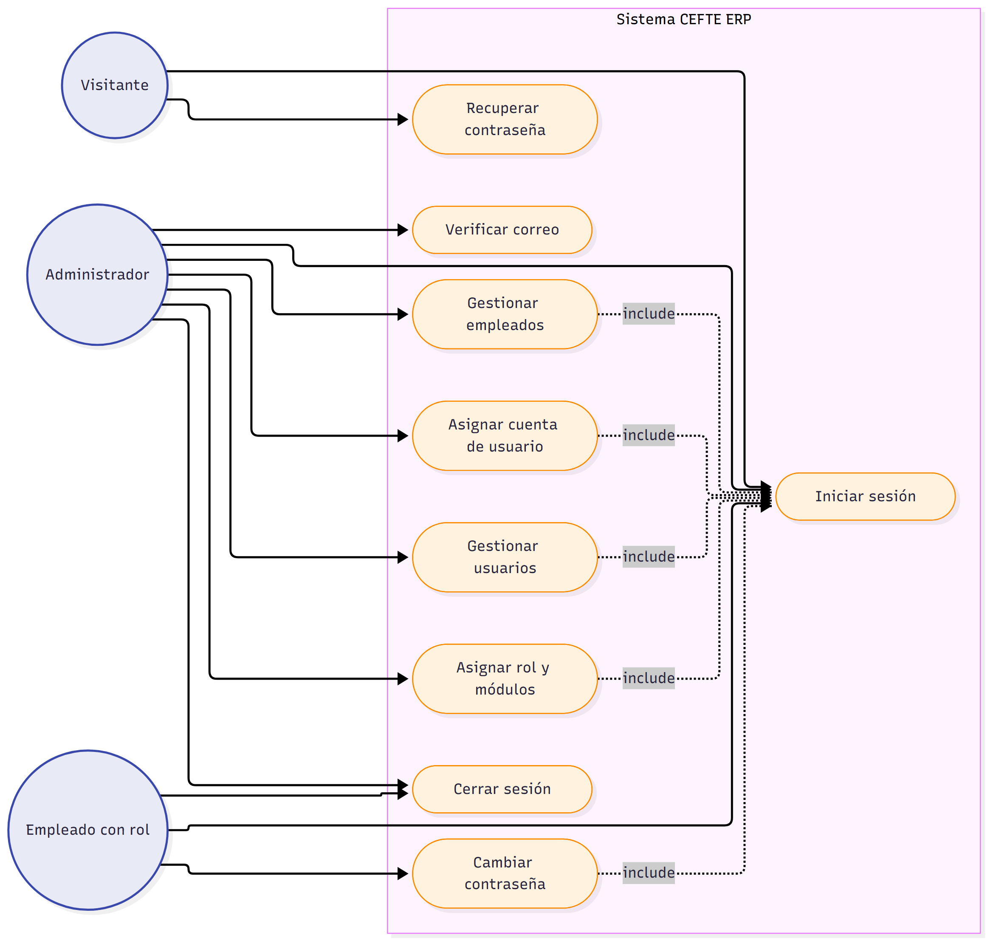
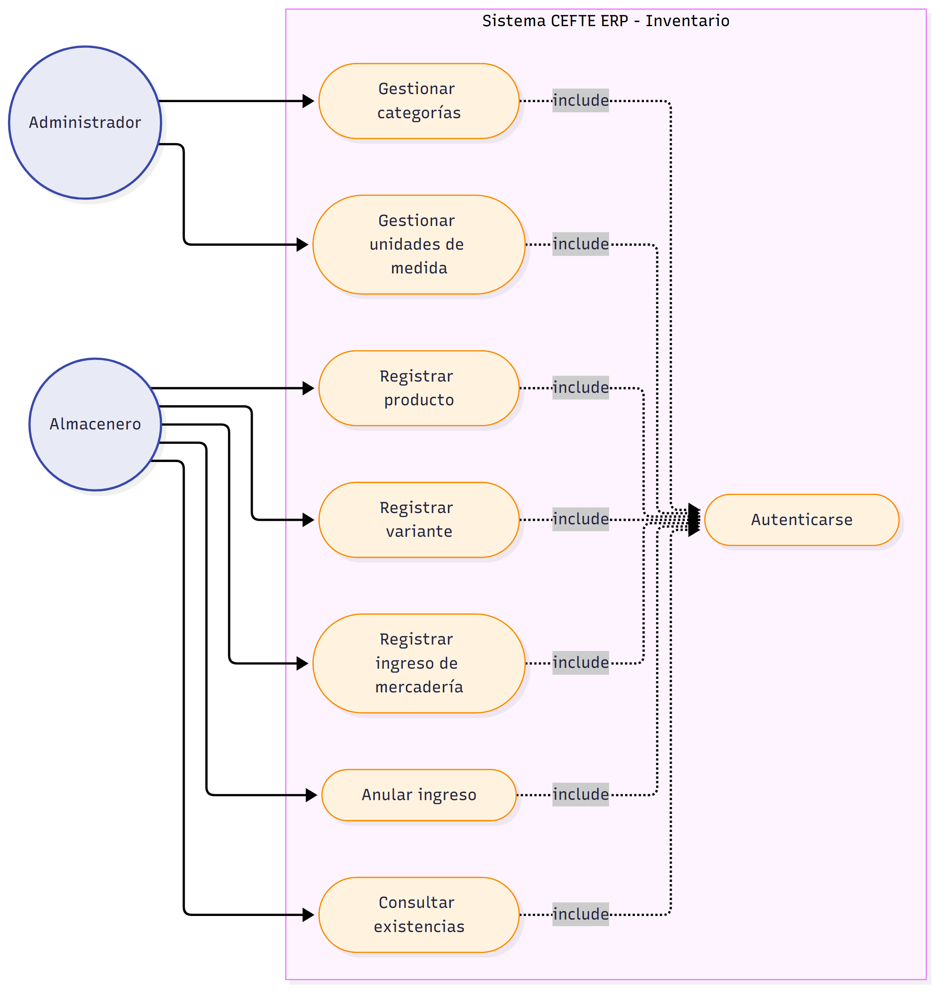
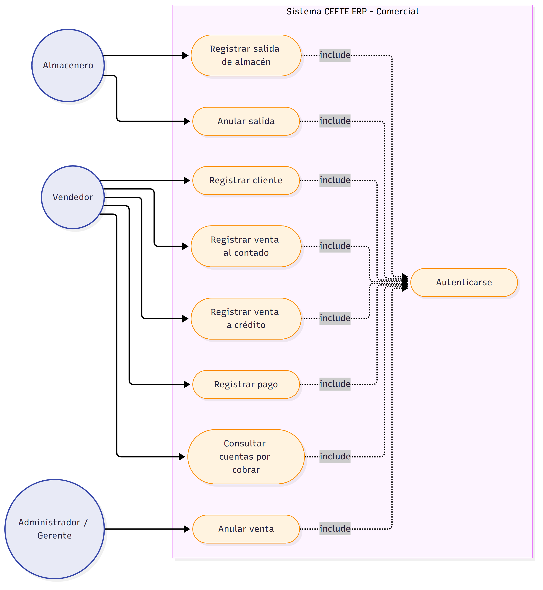
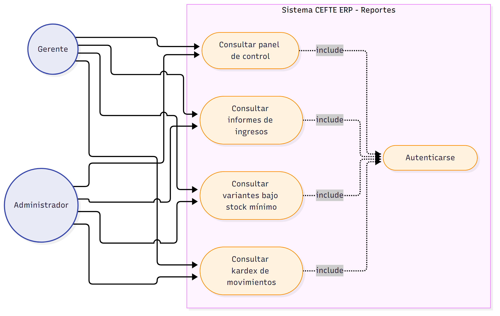

# Diagramas de casos de uso — CEFTE (metodología XP)

Los diagramas siguen el avance por iteraciones descrito en el Capítulo III.

| Iteración | Diagrama | Figura del capítulo |
|---|---|---|
| 1 | Acceso al sistema | Figura 1 |
| 2 | Gestión de inventario | Figura 10 |
| 3 | Ventas, salidas y pagos | Figura 20 |
| 4 | Panel de control e informes | Figura 28 |

## Actores

| Actor | Descripción |
|---|---|
| Visitante | Persona sin sesión iniciada; puede autenticarse o recuperar su contraseña. |
| Administrador | Administra empleados, cuentas, roles y módulos; acceso total. |
| Empleado con rol | Usuario autenticado (Gerente, Almacenero o Vendedor) con los módulos asignados. |
| Almacenero | Registra ingresos, controla existencias y registra salidas. |
| Vendedor | Registra clientes, ventas y pagos; consulta cuentas por cobrar. |
| Gerente | Supervisa, valida y anula documentos; consulta informes. |

---

## Iteración 1 — "Acceso al sistema"



| Código | Caso de uso | Actor(es) |
|---|---|---|
| UC-01 | Iniciar sesión | Visitante, Administrador, Empleado con rol |
| UC-02 | Cerrar sesión | Administrador, Empleado con rol |
| UC-03 | Recuperar contraseña | Visitante |
| UC-04 | Verificar correo | Administrador |
| UC-05 | Cambiar contraseña (obligatorio en el primer ingreso) | Empleado con rol |
| UC-06 | Gestionar empleados | Administrador |
| UC-07 | Asignar cuenta de usuario | Administrador |
| UC-08 | Gestionar usuarios | Administrador |
| UC-09 | Asignar rol y módulos | Administrador |

---

## Iteración 2 — "Gestión de inventario"



| Código | Caso de uso | Actor(es) |
|---|---|---|
| UC-00 | Autenticarse (*include*) | Todos |
| UC-01 | Gestionar categorías | Administrador |
| UC-02 | Gestionar unidades de medida | Administrador |
| UC-03 | Registrar producto | Almacenero |
| UC-04 | Registrar variante | Almacenero |
| UC-05 | Registrar ingreso de mercadería | Almacenero |
| UC-06 | Anular ingreso | Almacenero |
| UC-07 | Consultar existencias | Almacenero |

---

## Iteración 3 — "Ventas, salidas y pagos"



| Código | Caso de uso | Actor(es) |
|---|---|---|
| UC-00 | Autenticarse (*include*) | Todos |
| UC-01 | Registrar salida de almacén | Almacenero |
| UC-02 | Anular salida | Almacenero |
| UC-03 | Registrar cliente | Vendedor |
| UC-04 | Registrar venta al contado | Vendedor |
| UC-05 | Registrar venta a crédito | Vendedor |
| UC-06 | Registrar pago | Vendedor |
| UC-07 | Consultar cuentas por cobrar | Vendedor |
| UC-08 | Anular venta | Administrador / Gerente |

---

## Iteración 4 — "Panel de control e informes"



| Código | Caso de uso | Actor(es) |
|---|---|---|
| UC-00 | Autenticarse (*include*) | Todos |
| UC-01 | Consultar panel de control | Gerente, Administrador |
| UC-02 | Consultar informes de ingresos | Gerente, Administrador |
| UC-03 | Consultar variantes bajo stock mínimo | Gerente, Administrador |
| UC-04 | Consultar kardex de movimientos | Gerente, Administrador |

---

## Notación empleada

- **Actor:** figura circular con relleno azul.
- **Caso de uso:** elipse con relleno naranja.
- **Frontera del sistema:** rectángulo "Sistema CEFTE".
- **Asociación:** línea continua actor → caso de uso.
- **`include`:** línea punteada etiquetada `include`, usada para "Autenticarse" como prerrequisito.
- Si su institución exige la notación UML clásica (actor "monigote"), los `.mmd` de `docs/diagramas/casos_*.mmd` pueden importarse en <https://mermaid.live> o redibujarse en draw.io manteniendo la misma estructura.

## Regenerar las figuras

```powershell
npx -y @mermaid-js/mermaid-cli -i docs\diagramas\casos_iter1_usuarios.mmd -o docs\diagramas\casos_iter1_usuarios.png -b white -s 3
npx -y @mermaid-js/mermaid-cli -i docs\diagramas\casos_iter1_usuarios.mmd -o docs\diagramas\casos_iter1_usuarios.svg -b white
```
