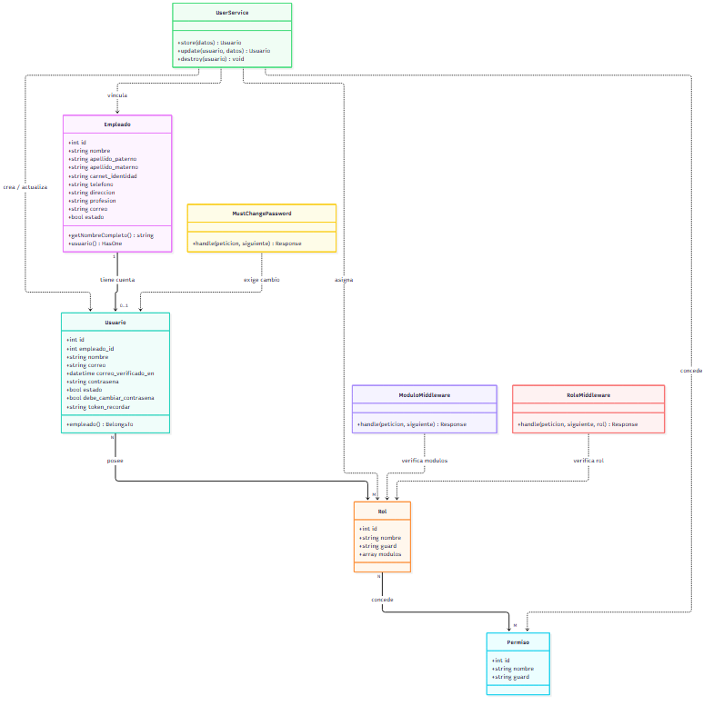
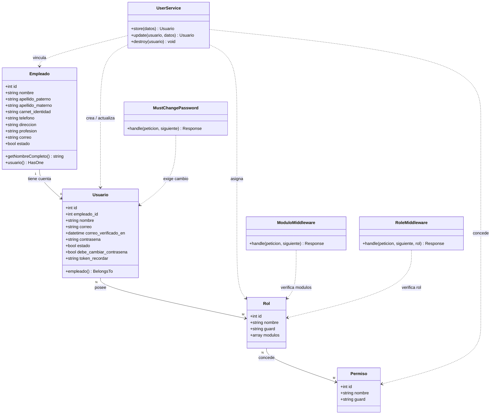
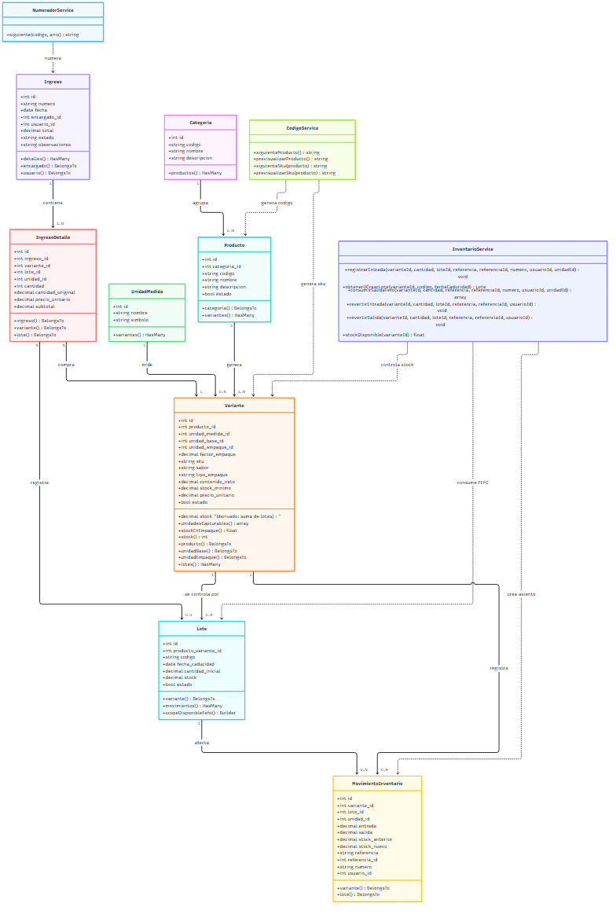
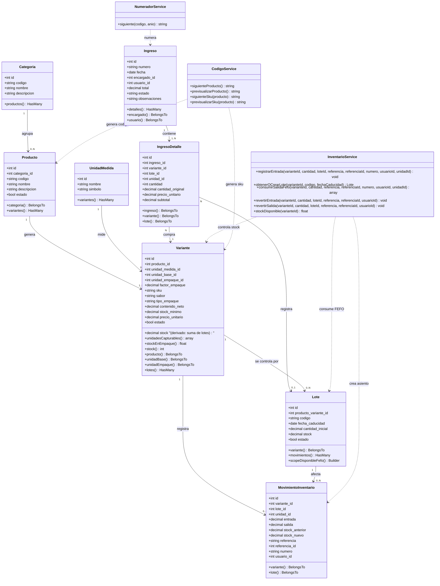
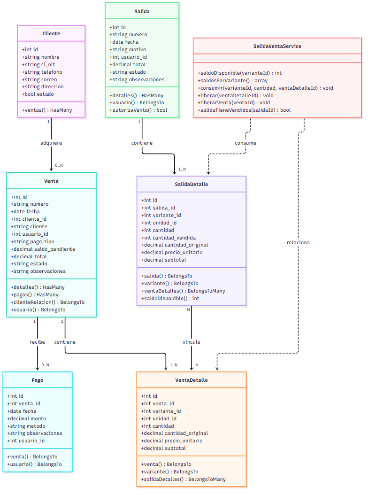
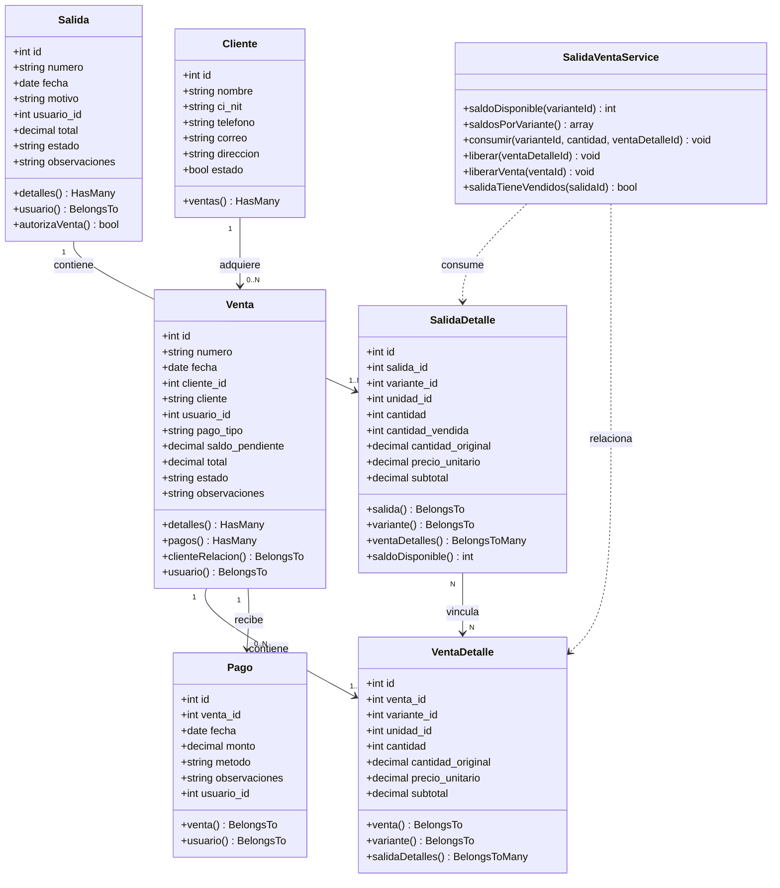
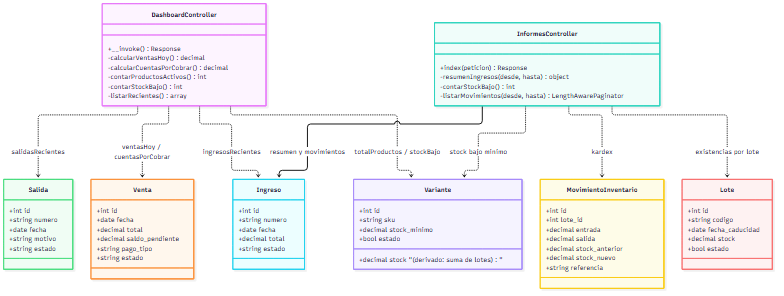
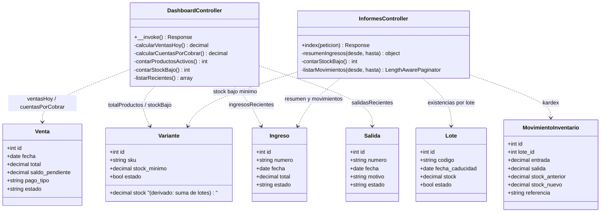

# Diagramas de clases — CEFTE (metodología XP)

Fuente: clases reales del sistema (`app/Models`, `app/Services`, `app/Http/Controllers`, `app/Http/Middleware`).

Los diagramas siguen el avance por iteraciones de la metodología XP descrito en el Capítulo III:

| Iteración | Diagrama | Figuras del capítulo |
|---|---|---|
| 1 | Usuarios | Figura 2 |
| 2 | Inventario | Figura 11 |
| 3 | Comercial | Figura 21 |
| 4 | Reportes | Figura 29 |

> **Nota de nomenclatura.** Las clases físicas del código están en inglés por herencia de Laravel (por ejemplo `User`, `ProductVariant`). En los diagramas se presentan con su **nombre equivalente en castellano** (`Usuario`, `Variante`). La sección [Equivalencias](#equivalencias-clase--código) permite rastrear cada clase hasta su archivo real.

## Convenciones UML

- `+` miembro público · `-` miembro privado/protegido.
- En atributos: `id` = PK, `_id` = FK.
- En relaciones: `1`, `0..1`, `1..N`, `0..N`, `N..N` indican la multiplicidad.
- La flecha punteada (`..>`) es una dependencia/realización: el servicio o controlador utiliza a la clase destino.

---

## Iteración 1 — Diagrama de clases "Usuarios"

Administración del personal, las cuentas de acceso y la autorización por rol y módulos.





**Historias cubiertas:** HU-01 (acceso al sistema), HU-02 (gestión de empleados y usuarios).

---

## Iteración 2 — Diagrama de clases "Inventario"

Catálogo de productos y variantes, unidades de medida y registro de ingresos con su efecto en el kardex.





**Historias cubiertas:** HU-03 (categorías), HU-04 (productos y variantes), HU-05 (ingresos de mercadería).

---

## Iteración 3 — Diagrama de clases "Comercial"

Salidas de almacén, ventas al contado y a crédito, y cobros con control del saldo pendiente.





**Historias cubiertas:** HU-06 (salidas), HU-07 (ventas), HU-08 (pagos).

---

## Iteración 4 — Diagrama de clases "Reportes"

Panel de control con indicadores e informes de ingresos y existencias.





**Historia cubierta:** HU-09 (panel de control e informes).

---

## Equivalencias clase ↔ código

| Clase en el diagrama | Clase / archivo real | Iteración |
|---|---|---|
| Empleado | `App\Models\Employee` | 1 |
| Usuario | `App\Models\User` | 1 |
| Rol | `Spatie\Permission\Models\Role` | 1 |
| Permiso | `Spatie\Permission\Models\Permission` | 1 |
| UserService | `App\Services\UserService` | 1 |
| ModuloMiddleware | `App\Http\Middleware\ModuloMiddleware` | 1 |
| RoleMiddleware | `App\Http\Middleware\RoleMiddleware` | 1 |
| MustChangePassword | `App\Http\Middleware\MustChangePassword` | 1 |
| Categoría | `App\Models\Category` | 2 |
| Producto | `App\Models\Product` | 2 |
| Variante | `App\Models\ProductVariant` | 2 |
| UnidadMedida | `App\Models\UnitMeasure` | 2 |
| Ingreso | `App\Models\Ingreso` | 2 |
| IngresoDetalle | `App\Models\IngresoDetalle` | 2 |
| MovimientoInventario | `App\Models\MovimientoInventario` | 2 |
| InventarioService | `App\Services\InventarioService` | 2 |
| CodigoService | `App\Services\CodigoService` | 2 |
| NumeradorService | `App\Services\NumeradorService` | 2 |
| Cliente | `App\Models\Cliente` | 3 |
| Venta | `App\Models\Venta` | 3 |
| VentaDetalle | `App\Models\VentaDetalle` | 3 |
| Pago | `App\Models\Pago` | 3 |
| Salida | `App\Models\Salida` | 3 |
| SalidaDetalle | `App\Models\SalidaDetalle` | 3 |
| SalidaVentaService | `App\Services\SalidaVentaService` | 3 |
| DashboardController | `App\Http\Controllers\Admin\DashboardController` | 4 |
| InformesController | `App\Http\Controllers\Admin\InformesController` | 4 |

### Atributos cuyo nombre físico está en inglés

| Clase | Atributo en el diagrama | Columna real |
|---|---|---|
| Empleado | nombre | first_name |
| Empleado | apellido_paterno | first_surname |
| Empleado | apellido_materno | second_surname |
| Empleado | carnet_identidad | identity_card |
| Empleado | telefono | phone |
| Empleado | direccion | address |
| Empleado | profesion | profession |
| Empleado | correo | email |
| Empleado | estado | is_active |
| Usuario | nombre | name |
| Usuario | correo | email |
| Usuario | contrasena | password |
| Usuario | estado | is_active |
| Usuario | debe_cambiar_contrasena | must_change_password |
| Usuario | token_recordar | remember_token |
| Rol/Permiso | nombre, guard | name, guard_name |
| Categoría/Producto | codigo, nombre, descripcion | code, name, description |
| Variante | sabor, tipo_empaque, contenido_neto, stock_minimo, precio_unitario | flavor, packaging_type, net_content, minimum_stock, unit_price |
| (varias) | variante_id | product_variant_id |
| (varias) | usuario_id | user_id |

---

## Regenerar las figuras

```powershell
npx -y @mermaid-js/mermaid-cli -i docs\diagramas\clases_iter1_usuarios.mmd -o docs\diagramas\clases_iter1_usuarios.png -b white -s 2
npx -y @mermaid-js/mermaid-cli -i docs\diagramas\clases_iter1_usuarios.mmd -o docs\diagramas\clases_iter1_usuarios.svg -b white
```

Si mermaid-cli no encuentra Chrome, indícale la ruta con `-p config.json`:

```json
{ "executablePath": "C:\\Program Files\\Google\\Chrome\\Application\\chrome.exe", "args": ["--no-sandbox"] }
```
